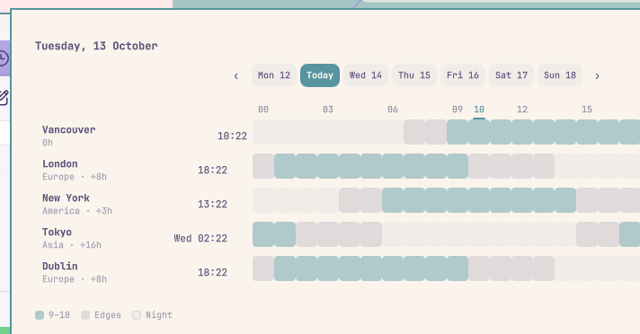
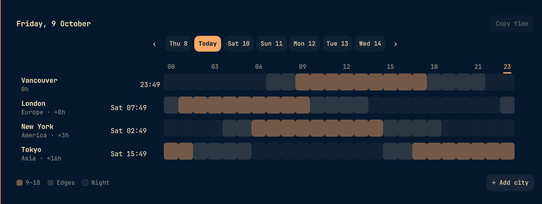

# Omaclock

A world clock for the Omarchy bar, with a meeting-planner panel in the
[worldtimebuddy.com](https://www.worldtimebuddy.com) shape: your cities
against the hours of a day, so "when can we all talk?" is answered at a
glance instead of with mental arithmetic.

| Light theme | Dark theme |
|---|---|
|  |  |
|  |  |

The bar label shows a chosen city's time rather than local (the built-in
clock already owns local) — above, Brisbane's time in the bar's center
section. The panel is the meeting planner: cities as rows, the day's hours
as shaded columns, hover to line everyone up. Both re-tint live with
`omarchy theme set`.

## The bar label

The widget shows a configured zone rather than local time — the built-in
clock already owns local. By default it follows the **second city** (the
first saved city), prefixed with its name: `London 18:20`. Left click opens
the planner, right click cycles the time format
(`HH:mm` → `ddd HH:mm` → `dd MMM HH:mm`), middle click launches the
[omaclock](https://github.com/CaptainAwesomeDi) app if you have it
installed.

What the label shows is the **Bar:** chip in the panel's footer — click it
to cycle the second city → each other saved city (Local is left out of the
cycle; the built-in clock already shows it) — or the `barZone` setting
(`"saved"`, `""`/`"local"`, or any zone id). `barShowCity` toggles the
city-name prefix; the zone's UTC offset is re-sampled hourly, so DST flips
land within the hour.

## The panel

- **City rows** — your local zone pinned first (auto-detected), then saved
  cities, each with its live time and offset from home (`Europe · +8h`).
  Hover a row's ✕ to remove it; the home row stays.
- **The hour grid** — 24 columns for the selected day. Each cell is shaded
  by *that city's* hour: business hours (default 9–18) carry the theme
  accent, shoulder hours a mid tint, night a quiet one. A column that reads
  accent top-to-bottom is a workable meeting time for everyone.
- **The slider** — hover any column to line every city up at that instant:
  each row's time (and weekday, when the city is already into tomorrow)
  rewrites live. Click to pin; the **Copy time** button then copies a
  shareable line like
  `Fri 15:00 Vancouver · 23:00 London · Sat 08:00 Tokyo`.
  ◀/▶ (or the ‹ › chips) slide the pinned hour.
- **Day chips** — Today plus six days out; today's current hour is marked
  with an accent underline.
- **Add city** — type-to-filter over the IANA zone catalog (`/usr/share/
  zoneinfo/zone.tab` + `iso3166.tab`, with a built-in fallback). City
  names rank first, but country names ("ireland", "japan") and cities the
  tz database doesn't name resolve too — Cork → Europe/Dublin, New Delhi
  → Asia/Kolkata, Osaka → Asia/Tokyo, Seattle → America/Los_Angeles —
  with the matched name shown on the row. Enter adds the top match.

Esc closes (or dismisses the picker first); a click outside closes.

## Settings

Stored inline on the widget's entry in `~/.config/omarchy/shell.json`:

| Key | Type | Default | Meaning |
|---|---|---|---|
| `zones` | string[] | London, New York, Tokyo | Saved cities (home is automatic) |
| `barZone` | string | `saved` | What the bar label shows: `saved` = second city, `""`/`local` = local time, or a zone id |
| `barShowCity` | bool | true | Prefix the bar time with the city name |
| `businessStart` | int | 9 | First business hour |
| `businessEnd` | int | 18 | Hour after the last business hour |
| `use24h` | bool | true | 24-hour times and hour labels |

Adding/removing cities in the panel persists them immediately. The
business-hours window is the shaded 9–18 by default; edit the values in
`shell.json` if you want a different day shape (the shell hot-reloads on
save).

## IPC

```
omarchy-shell shell summon io.github.captainawesomedi.omaclock '{}'   # open
omarchy-shell shell toggle io.github.captainawesomedi.omaclock        # toggle
omarchy-shell shell hide   io.github.captainawesomedi.omaclock        # close
```

## Install

```
git clone https://github.com/CaptainAwesomeDi/omaclock-widget \
  ~/.config/omarchy/plugins/io.github.captainawesomedi.omaclock
omarchy restart shell
```

Then enable **Omaclock** from the bar's widget picker, or
`omarchy plugin enable io.github.captainawesomedi.omaclock`.

## Removal

```
omarchy plugin disable io.github.captainawesomedi.omaclock
rm -rf ~/.config/omarchy/plugins/io.github.captainawesomedi.omaclock
```

The widget also keeps a small settings entry in `~/.config/omarchy/shell.json`
(a `zones` list, the bar-zone choice and business hours, nested under
`bar.layout`); delete that entry too if you want every trace gone. Nothing
else is written outside the plugin folder.

## Notes

- Timezone offsets come from coreutils `date` (`TZ=<zone> date -d @<epoch>
  +%z`), batched into one subprocess per zone-day — the QML engine has no
  `Intl`, and this stays exact across DST for every IANA zone.
- Colors follow the Omarchy theme and re-tint live (`omarchy theme set`).
- MIT licensed; no dependencies beyond Omarchy's shell.
